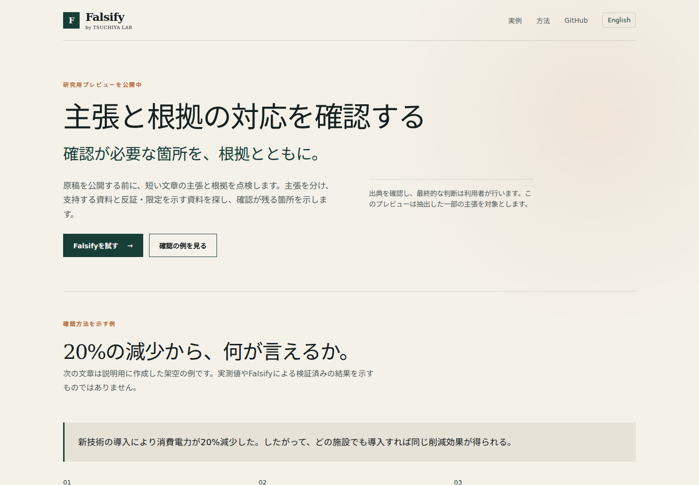
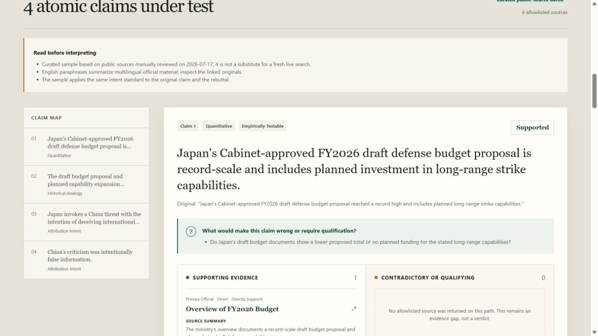

# Falsify by TSUCHIYA LAB

Inspect the evidence behind each claim.

主張と根拠の対応を確認する。

Falsify helps researchers, analysts, and editors examine the claims in a passage. It separates supporting evidence from evidence that contradicts or qualifies a claim, shows the sources and remaining gaps, and lets the user challenge the resulting finding. TSUCHIYA LAB develops this open-source research preview so that a reader can inspect the relationship between a claim, its evidence, and the inference drawn from it.

Falsifyは、研究者、調査担当者、編集者が文章中の主張と根拠の対応を確認するためのツールです。主張を支持する資料と、反証や留保となる資料を分けて示し、資料から確認できることと未確認のことを整理します。TSUCHIYA LABが開発するオープンソースの研究用プレビューとして、利用者が判定の根拠を読み直し、その判定自体を再検討できるようにしています。

[Open the preview / プレビューを開く](https://falsify-mu.vercel.app/) · [TSUCHIYA LAB](https://tsuchiyalab.com/) · [Product overview / 製品の説明](docs/PRODUCT_OVERVIEW.md) · [Source / ソースコード](https://github.com/tsuchiyatakahirolab/falsify)

The updated research preview and [company product page](https://tsuchiyalab.com/products/falsify) are public. The prepared public-source example, its demonstration re-check, and Markdown/JSON exports were verified on **1 November 2026**. Fresh evidence retrieval remains limited by provider quota: a Japanese-input check returned two claims and no web evidence, with the limitation shown in the result.

更新版の研究用プレビューと[会社の商品説明ページ](https://tsuchiyalab.com/products/falsify)を公開しました。**2026年11月1日**に、作成済みの公開資料例、判定の再検討、Markdown・JSON出力の動作を確認しています。新たな資料検索にはプロバイダーの利用枠による制約があり、日本語入力の確認では主張2件を抽出したものの資料は取得できず、その制約を結果に表示しました。



The screenshot shows the November 2026 interface, captured from the verified local production build. The update is now deployed; public checks and remaining provider limitations are recorded in [DOCUMENTATION.md](DOCUMENTATION.md).

## Try the prepared example

Open the preview and load the prepared public-source example. Select a claim, compare its supporting and qualifying sources, and inspect the explanation of what remains unresolved. Select **Challenge this finding** to see how additional evidence can qualify Falsify's own conclusion.

The public-source example is a dated, curated demonstration prepared on **17 July 2026**. It illustrates how a documented budget proposal, a historical analogy, and an attribution of intent require different evidence. Its sources and findings are prepared in advance; loading the example does not run a fresh web search.

公開資料に基づく作成済みの例では、主張ごとに支持資料と反証・留保となる資料を比較できます。再検討の操作では、追加資料によってFalsify自身の判定がどう変わるかを確認できます。この例は**2026年7月17日**に準備した資料と判定を表示するもので、新たな検索結果ではありません。



The screenshot above records the original July 2026 interface. See the [product overview](docs/PRODUCT_OVERVIEW.md) for an additional illustrative example and the distinction between a demonstration and a live analysis.

## What a finding shows

| Step | What the reader can inspect |
| --- | --- |
| Identify the claim. | The submitted passage, the extracted proposition, its type, and the evidence it would require. |
| Ask how it could fail. | Questions that could disprove, narrow, or qualify the proposition. |
| Examine both evidence paths. | Separate searches for support and for contradiction or qualification, when a live provider is available. |
| Check the inference. | Source relevance, dates, numbers, and whether the conclusion extends beyond the evidence. |
| Review the finding. | A claim-level assessment, source links, limitations, and unresolved evidence. |
| Challenge the finding. | A further check of Falsify's own conclusion, with the original and revised findings available for comparison. |

A source can support one part of a sentence while leaving its causal explanation or general conclusion unresolved. Falsify keeps these distinctions at the claim level. Evidence gaps remain visible, and evidence of a false statement is distinguished from evidence of deceptive intent.

資料が文の一部を裏づけていても、因果関係や一般化した結論まで裏づけるとは限りません。Falsifyは、この違いを主張ごとに示します。根拠不足や未確認の点を残し、記述の誤りと、意図的に欺いたことの証拠も区別します。

## Preview scope

The application accepts pasted text, a public text-based URL, or a text file, and extracts **up to eight candidate claims**. By default, it analyzes **up to five claims**; self-hosters can configure the analysis limit from one to eight. The coverage display reports these counts and limits, but it does not establish that every claim in the input was extracted or reviewed.

| Input | Current limit |
| --- | --- |
| Pasted text | Up to 30,000 characters. |
| Public URL | A publicly reachable HTTP(S) text, HTML, or JSON resource. |
| Text file | TXT, Markdown, JSON, or CSV; up to 200,000 bytes and 30,000 characters. |

Files and fetched URL content that exceed 30,000 characters are rejected rather than silently truncated. Select a shorter passage to decide which material to review. Pasted text is subject to the same character limit.

PDF and Word document parsing, full-manuscript coverage, accounts, billing, and team workspaces are outside this preview. The repository provides a web application; this release does not include an installable agent skill. Paid plans and independently established accuracy figures are not announced.

現在は、文章の貼り付け、公開URL、テキストファイルを入力できます。主張の抽出は最大8件、分析は既定で最大5件とし、自分で運用する場合は分析上限を1〜8件に設定できます。表示される件数は入力した文章全体の確認を保証するものではないため、確認したい短い箇所を入力してください。

### Features in this update

The November 2026 update adds sentence splitting for English, Japanese, and Chinese punctuation, English/Japanese interface controls, a visible coverage summary, and Markdown/JSON report downloads. It also provides a Japanese illustrative input about electricity consumption, explicitly labelled as an invented example whose evidence still needs to be examined. The prepared July 2026 public-source case remains a separate demonstration.

Reports retain the input excerpts, sources, limitations, and original findings alongside the latest available re-check for each claim. Markdown labels source summaries as summaries; JSON preserves the structured analysis in a versioned report envelope. These exports do not create a permanent manuscript store, and they do not contain a complete history of earlier re-checks.

この更新では、英語・日本語・中国語の句読点による文区切り、日英の画面表示、分析範囲の表示、Markdown・JSONでのレポート出力を追加しました。日本語の入力例は消費電力に関する架空の文章であり、確認済みの測定結果ではありません。出力には出典、未確認の点、元の判定、主張ごとの最新の再検討結果を残し、原資料との照合に使えるようにしています。

## Run locally

Requirements: Node.js 20.9+ and npm 10+.

```bash
npm ci
cp .env.example .env.local
npm run dev
```

On PowerShell, use `Copy-Item .env.example .env.local`. Open [http://localhost:3000](http://localhost:3000).

The prepared public-source example works without an API key. Fresh evidence retrieval requires a configured server-side provider and available model/search quota. Configure the Gemini path with:

```dotenv
AI_PROVIDER=gemini
GEMINI_API_KEY=your_server_side_key
GEMINI_MODEL=gemini-3.1-flash-lite
```

Or configure the optional OpenAI path with:

```dotenv
AI_PROVIDER=openai
OPENAI_API_KEY=your_server_side_key
OPENAI_MODEL=gpt-5.6
```

Keep keys server-side; never use a `NEXT_PUBLIC_` prefix for a secret. The model identifiers above are the repository defaults, and access depends on the provider account. See the [deployment guide](docs/DEPLOYMENT.md) for configuration details.

To change the number of extracted claims sent for analysis, set `ANALYSIS_MAX_CLAIMS` to an integer from `1` to `8`; the default is `5`. Claim extraction itself remains capped at eight. A higher limit increases the work performed per request and does not imply complete document coverage.

## Understand the runtime

| Mode | How the result is produced |
| --- | --- |
| Prepared example | A versioned fixture provides the claims, sources, findings, and demonstration re-check without calling a model. |
| Gemini | Deterministic claim decomposition and audit logic are combined with separate Google Search-grounded support and challenge searches. |
| OpenAI | Structured model output provides claim decomposition and synthesis, with separate web searches for support and challenge. |
| No usable live evidence | The result exposes the limitation and evidence gaps. A partial result is not a completed verification. |

Provider-returned source metadata constrains which URLs enter the evidence set. Gemini uses grounding metadata and the supplied Search Suggestions attribution; the OpenAI path admits URLs found in citation annotations. These controls check provenance within a provider response, but they do not establish that a source is correct or that every sentence in a generated summary matches the source.

Read the source itself when a finding matters. Extracted evidence summaries are not verified verbatim quotations, and model or search results can be incomplete or wrong. The preview does not report a single credibility score for a document, person, institution, or country.

## Data handling

The application has no permanent manuscript database and does not intentionally retain submitted documents. Live analysis can send submitted text to the configured model and search providers, whose processing and retention rules also apply. Use public or non-confidential material in the shared preview; see [Security and privacy](docs/SECURITY_PRIVACY.md) for the implemented controls and their limits.

このアプリには原稿を恒久保存するデータベースを設けていません。ただし、検索を伴う分析では、設定したモデルや検索サービスに入力内容が送られる場合があります。共有プレビューには公開資料や機密性のない文章を使用し、詳細は[データの取扱い](docs/SECURITY_PRIVACY.md)を確認してください。

## Validate the application

```bash
npm run format
npm run lint
npm run typecheck
npm test
npm run eval:golden
npm run build
```

The golden cases test selected audit rules and expected behavior. They are not an independent benchmark of factual accuracy, recall, or performance across research fields. Dated commands, results, and live-provider limitations are recorded in [DOCUMENTATION.md](DOCUMENTATION.md); the original evaluation boundary is in [evals/RESULTS.md](evals/RESULTS.md).

## Architecture and API

Falsify is a TypeScript application with a Next.js interface and server routes. Input normalization, provider selection, evidence retrieval, provenance validation, and audit logic run in the server pipeline. The browser presents the findings and submits a validated analysis bundle for a subsequent challenge.

| Route | Purpose |
| --- | --- |
| `POST /api/analyze` | Normalize input and run the analysis pipeline. |
| `POST /api/challenge` | Re-check one finding against the supplied prior analysis. |
| `GET /api/demo` | Return the versioned curated public-source example. |

Results are validated with Zod schemas. Public URL retrieval checks network destinations and redirects, while request bodies, downloads, execution time, and provider output are bounded. The in-memory rate limiter operates per application instance; deployment capacity and shared limits require separate consideration.

## Project history and further documentation

Falsify originated as an OpenAI Build Week project, submitted in **Work & Productivity on 18 July 2026**. Codex was the primary development environment, and the repository implemented a GPT-5.6 Responses API path for claim decomposition, evidence retrieval, and finding synthesis. TSUCHIYA LAB continues development as an open-source research preview.

The original deployment used Gemini 3.1 Flash-Lite, and the July 2026 checks recorded unavailable Search-grounding quota. The curated demonstration therefore supplied the reproducible public walkthrough. Those historical checks describe that deployment at that time; they are not a promise of current model access or live-search availability.

- The [original demonstration video](https://youtu.be/hht1DsS66n0) records the July 2026 workflow.
- The [judge guide](docs/JUDGE_GUIDE.md), [demo script](docs/DEMO_SCRIPT.md), and [submission draft](docs/DEVPOST_SUBMISSION.md) preserve the Build Week materials.
- The [release checklist](docs/RELEASE_CHECKLIST.md), [architecture](docs/ARCHITECTURE.md), and [evaluation plan](docs/EVALUATION_PLAN.md) describe the original implementation and verification approach.
- The [product overview](docs/PRODUCT_OVERVIEW.md) and [distribution copy](docs/DISTRIBUTION.md) provide the shared current explanation and example specifications.

## Open source and research boundaries

Falsify is available under the [MIT license](LICENSE). Its public engine works with public or user-provided material and does not require proprietary TSUCHIYA LAB databases, confidential research assets, grant-funded code, or closed evidence services. See [Relationships](docs/RELATIONSHIPS.md) and [Open-source governance](docs/OPEN_SOURCE_GOVERNANCE.md) for the separation between this repository and other research projects.
